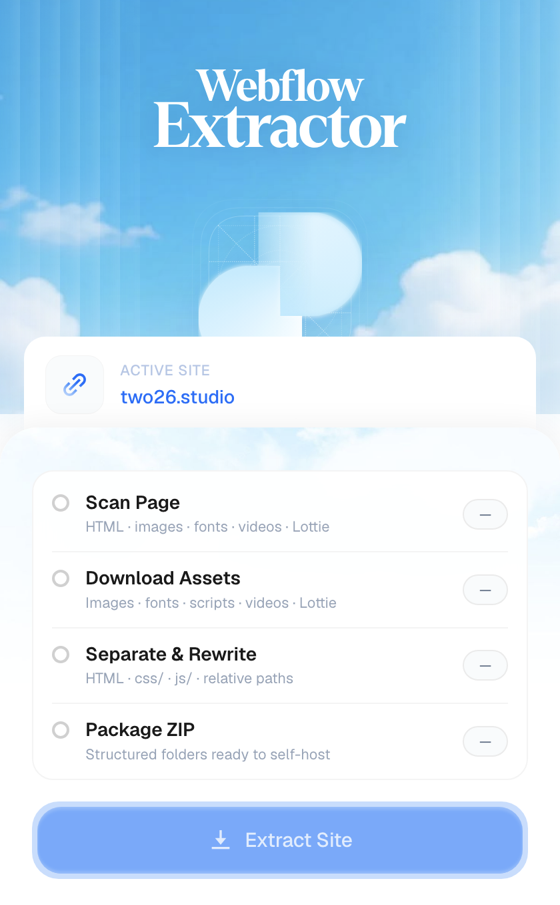

<p align="center">
  
</p>

<h1 align="center">Webflow Extractor</h1>

<p align="center">
  <b>Export any Webflow website to clean HTML, CSS &amp; JS — with every page, every CMS item and a built-in CMS to keep editing it.</b><br>
  Self-host free on Netlify, Vercel, GitHub Pages or any web host.
</p>

<p align="center">
  
  
  
  
</p>

<p align="center">
  
</p>

---

## Why

Webflow's code export leaves out your CMS content, and it isn't available on every plan. Webflow Extractor exports everything, straight from your browser:

1. Open a published Webflow site.
2. Click the extension.
3. Download a ready-to-deploy static site.

No account, no paywall. The export runs on your computer, and nothing is uploaded anywhere.

## Features

- **Full site export.** Every page is found from your sitemap and links, including pages that aren't in the menu. Images, videos, fonts, Lottie files, CSS and JS are downloaded and rewritten to local paths, so nothing loads from Webflow's servers.
- **Webflow CMS support.**
  - Every collection item page is exported, along with collection lists, paginated lists (`page-2`, `page-3`…) and RSS feeds.
  - The CMS structure is detected automatically:
    - Collections and their fields (text, rich text, images, links).
    - References and multi-references, such as authors, categories and tags.
    - Lists that have no page of their own, such as testimonials, FAQs and team members.
- **Built-in CMS at `/cms`.** Edit your content after export, with a live preview of your site beside it:
  - Rename, add, duplicate, reorder or delete items.
  - Pick references from a list. Renaming an author or category updates every post that shows it.
  - When you change a slug, links update on every page.
  - Paginated lists and sliders refill in order.
  - Light and dark mode, and a password when hosted.
- **Publish your way.** Save straight into your site folder, commit to GitHub (Vercel, Netlify and Cloudflare redeploy automatically), or go live in seconds with Vercel Blob.
- **Move your content anywhere.** One-click exports for WordPress, Notion, Airtable, Google Sheets, CSV and JSON.
- **SEO-ready.** Includes `sitemap.xml` and `robots.txt`. Your Webflow 404 page is kept (a styled one is added if the site has none). Canonical tags and social preview images point to your new domain.
- **One-command local preview.** Run `npm start`, or double-click on Mac or Windows. The terminal shows the links to your site and your CMS.
- **Works with AI coding tools.** Every export includes an `AGENTS.md`, so Claude Code, Codex or Cursor can run it, deploy it and set up the CMS for you.

## Install

1. Download or clone this repository:

   ```bash
   git clone https://github.com/CHAITANYASAI-del/Webflow-Extractor.git
   ```

2. Open `chrome://extensions` and turn on **Developer mode**.
3. Click **Load unpacked** and pick the `Webflow-Extractor` folder.

## How to use

1. In Chrome, open your **published** Webflow site (for example `yoursite.webflow.io` or your custom domain).
2. Click the **Webflow Extractor** icon, then **Extract Site**.
3. Unzip the download and run it locally:

   ```bash
   cd your-site-folder
   npm start
   ```

   The terminal shows **Your site** (`http://localhost:8080`). If your site uses Webflow CMS, it also shows **CMS** (`http://localhost:8080/cms/`).
4. Deploy the folder to any host. Each export comes with its own `README.md`, which covers:
   - Deploying to Netlify, Vercel and GitHub Pages.
   - Setting up the CMS on a live site.

## What works in the export

| Works | Needs Webflow's servers |
|---|---|
| All pages, interactions and animations | Forms (connect Formspree, Netlify Forms or similar) |
| CMS item pages, lists, pagination, RSS | Site search |
| Editing content in the built-in CMS | Ecommerce and memberships |
| Your own analytics and embeds | List filter and sort rules set in Webflow (the CMS follows what each list showed) |

## Repository layout

```
Webflow-Extractor/     The Chrome extension (Manifest V3). Load this folder into Chrome.
├─ manifest.json
├─ popup.html/.css/.js   Export UI
├─ core.js               Export engine: crawl, download, rewrite, package
├─ webflow-cms.js        Webflow CMS detection (collections, fields, references)
├─ content.js            Reads the page you're on
├─ admin-dist/           Built CMS editor, copied into every export as /cms
├─ site-kit/             Files added to exports: preview server, CMS save API,
│                        Vercel middleware, Netlify functions
├─ admin-src/            Source of the CMS editor (React + Vite)
├─ design/               Original logo and title artwork
└─ dev/                  Test tools (export harness, CMS QA, link checker)
```

### Building the CMS editor

The extension already includes a built copy in `admin-dist/`. To rebuild it after changing `admin-src/`:

```bash
cd admin-src
npm install
npm run build
```

### Running the tests

```bash
cd dev
npm install
node harness.cjs https://two26.studio/ out/two26
mkdir -p out/two26-x && unzip -q out/two26/site.zip -d out/two26-x
node qa.mjs out/two26-x/*
```

The steps above export a site and then run CMS edit scenarios and a broken-link check on it. See [dev/README.md](dev/README.md) for the other tools.

## Privacy

Webflow Extractor runs entirely in your browser. It has no server, collects no analytics, and never sends your site or content anywhere. It only downloads:

- The files of the Webflow site you are exporting.
- The popup's own fonts, from Google Fonts.

## License

**Source-available, not open source.** You can:

- Read the code and use the extension.
- Do whatever you like with the websites you export, including the CMS and server files added to them.

Copying, reusing or redistributing this code, or publishing a modified version of the extension, needs written permission. See [LICENSE](LICENSE).

Webflow is a trademark of Webflow, Inc. Webflow Extractor is an independent tool and is not affiliated with or endorsed by Webflow.

---

<p align="center">Crafted &amp; developed by <b>Chaitanya Sai</b></p>
